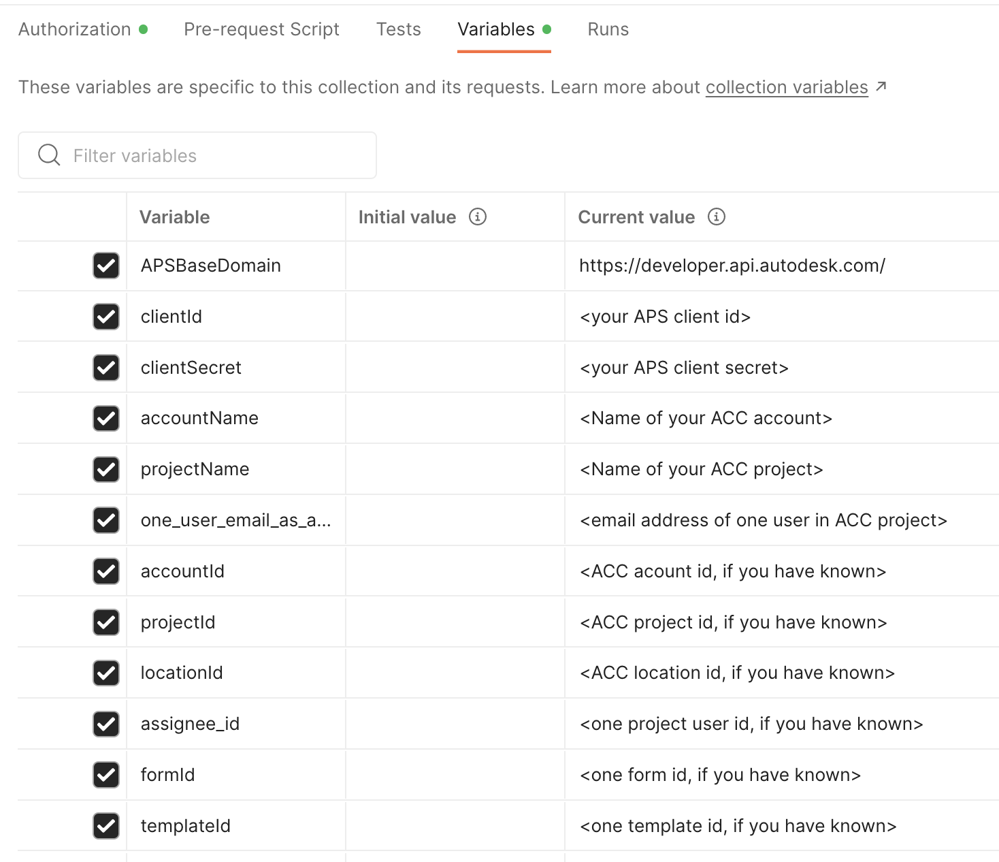

# Postman Collection for Forms API

[](https://www.getpostman.com/)

[](https://aps.autodesk.com/en/docs/oauth/v2/overview/)

[](https://aps.autodesk.com/en/docs/acc/v1/overview/)

[](https://aps.autodesk.com/en/docs/acc/v1/overview/field-guide/forms/)


[](http://opensource.org/licenses/MIT)

## Description
This folder contains a Postman Collection that includes all the endpoints of current ACC Forms API and the demo tutorials. The collection will be kept updated with new APIs.  

Requests marked **[new]** cover the current Forms API, including v2 form retrieval and value updates. Requests marked **[deprecated]** retain the original v1 examples for migration purposes. The deprecated v1 `GET forms` and `PUT values:batch-update` endpoints will retire on **June 30, 2027**. Listing templates, creating forms, and patching form details remain unchanged.

### Setup Postman environment

- Import Postman collection file. It contains the endpoints test, predefined **variables** of collection enviroment and predefined **Authorization**. The endpoints test includes _Run Firstly_ which gets account id, project id, assignee id etc firstly. Tutorials includes a few demo workflows. API Reference provides the demo of each API endpoint.

- Input your information in  **variables** tab
   Set `APSBaseDomain` to `https://developer.api.autodesk.com/` (including the trailing slash). Set `projectId` without the Data Management API's `b.` prefix.

   If you want to test from _Run Firstly_, input the environment variables only: clientId, clientSecret, accountName, projectName, one_user_email_as_assignee. 

   If you want to test specific endpoints directly, input the necessary data in advance (e.g. projectId, formId etc..)

    <p align="center"></p>  

- ensure the callback url of your APS application is 
```https://www.getpostman.com/oauth2/callback```


### Current API demos [new]

Use the **[new]** requests at the start of **API References** for new integrations. They inherit the collection's OAuth authorization. Generate a three-legged user-context token with `data:read` for retrieval and `data:write` for updates/deletion, and ensure the user has the appropriate Forms permissions.

| Demo | Method and route (after `/construction/forms/`) |
| --- | --- |
| [Get Forms v2](https://aps.autodesk.com/en/docs/acc/v1/reference/http/forms-forms-v2-GET/) | `GET v2/projects/:projectId/forms` |
| [Get Layout](https://aps.autodesk.com/en/docs/acc/v1/reference/http/forms-layouts-layoutId-GET/) | `GET v1/projects/:projectId/layouts/:layoutId` |
| [Get Layout Section](https://aps.autodesk.com/en/docs/acc/v1/reference/http/forms-sections-sectionId-GET/) | `GET v2/projects/:projectId/layouts/:layoutId/sections/:sectionId` |
| [Get Custom Field Values](https://aps.autodesk.com/en/docs/acc/v1/reference/http/forms-custom-values-GET/) | `GET v2/projects/:projectId/forms/:formId/values` |
| [Get Table Values](https://aps.autodesk.com/en/docs/acc/v1/reference/http/forms-get-table-values-GET/) | `GET v1/projects/:projectId/forms/:formId/table/:fieldId/values` |
| [Get PDF Field Values](https://aps.autodesk.com/en/docs/acc/v1/reference/http/forms-pdf-values-GET/) | `GET v2/projects/:projectId/forms/:formId/pdf-values` |
| [Get Project Weather Record](https://aps.autodesk.com/en/docs/acc/v1/reference/http/forms-get-weather-data-for-a-project-GET/) | `GET v3/projects/:projectId/weather/:weatherId` |
| [Update Custom Field Values / Upsert Built-in or Custom Table Row v2](https://aps.autodesk.com/en/docs/acc/v1/reference/http/forms-valuesbatch-update-v2-PUT/) | `PUT v2/projects/:projectId/forms/:formId/values:batch-update` |
| [Delete Table Row v2](https://aps.autodesk.com/en/docs/acc/v1/reference/http/forms-valuesbatch-delete-POST/) | `POST v2/projects/:projectId/forms/:formId/values:batch-delete` |

New does not always mean v2: layout and table-value retrieval use **v1**, while weather uses **v3**.

#### Discover a form and its field definitions

1. Run **Get Forms v2 [new]**. Set collection variable `formId` to the desired web form's `data[].id`, `templateId` to its `formTemplateId`, and `layoutId` to its `nativeForm.layoutId`. Optional filters are disabled in the Params tab; enable them as needed. V2 uses `sort` (for example `updatedAt desc,formNum asc`), not `sortBy`/`sortOrder`. Its statuses are `inProgress`, `inReview`, `closed`, `discarded`, and `archived`, rather than the v1 labels used by the unchanged create/PATCH requests.
2. Run **Get Layout [new]** and copy the desired `sections[].uid` into `sectionId`.
3. Run **Get Layout Section [new]**. The response provides field definitions, table columns, and conditional actions:
   - For a non-tabular question, `sectionItems[].schema` is the `fieldId`; `valueName` determines the answer property.
   - For a table (`type: table`), copy its `schema` into `tableFieldId`, not the table item's `uid`.
   - For a custom table column, copy its `uid` from the matching `tableColumns` entry into `columnId`; its `layoutSectionItemUid` references the table item. The custom-table demo expects a text column; change the payload's value property for other `columnType` values.

The new demos deliberately do **not** automatically select forms, fields, or rows or overwrite these variables. Select matching IDs from the responses before sending a request, especially a write or delete.

#### Retrieve values

- **Get Custom Field Values [new]** returns persisted non-tabular answers. Unanswered questions are absent. Join `data[].fieldId` to the layout item's `schema` for labels and types, and filter out entries marked `deleted: true`. Optional `fieldIds` (repeatable) and `sectionUid` filters are included.
- **Get Table Values [new]** uses `tableFieldId` as the URL's `fieldId`. Use the schema UUID from the layout for custom tables. For built-in tables, use Work Log `6c8055d5-1301-46f6-9d18-8a2a208a277e`, Materials `2adf5ad9-d9d3-ee42-6fd8-015c34ce474d`, or Equipment `8af6c450-dd2a-32ae-0090-5493a9cc884e`. Row IDs are in `data[].id`; column values use `columnId`.
- **Get PDF Field Values [new]** uses the separate `pdfFormId` variable. Set it to a PDF form's ID from **Get Forms v2**, with an associated `pdfFile`. This returns name/value pairs, not PDF bytes; empty values can be `null`, and signature fields are not extracted. Download the document using `pdfFile.pdfUrl` from the form listing.
- **Get Project Weather Record [new]** uses `weatherId` from a form that captured weather. Results use Celsius, km/h, and mm.

All paginated demos expose `offset` and `limit`. Follow `pagination.nextUrl` or increase the offset by the number of records returned until the last page. Maximum limits differ: forms 50, custom values 100, table rows 250, and PDF values 200.

#### Update and delete test data

Use an editable draft form (`inProgress` in v2 responses). These requests modify real data; run them individually against test forms, **not the entire API References folder against production**.

- **Update Custom Field Values v2 [new]** writes a text answer using `fieldId`. Its description explains the alternate number, date, toggle, choice, array, and signature value properties. Use the property's type and any choices defined by the layout.
- **Upsert Built-in Table Row v2 [new]** demonstrates Work Log columns with `columnName`, including a duration in milliseconds. The request description also explains Materials and Equipment variants.
- **Upsert Custom Table Row v2 [new]** uses `tableFieldId` as `schema` and a UUID `columnId`, **not** `columnName`. Custom tables require a compatible template (`nativeForm.version` 13.0 or higher). For either row-upsert demo, set `rowId` to a newly generated UUID to insert or an existing row ID to update. Reuse the UUID for subsequent edits; choose a different UUID for each new row.
- **Delete Table Row v2 [new]** deletes only table rows, not custom-field answers. Explicitly set `rowId` to the test row to remove and `tableSchema` to that row's table: `worklogEntries`, `materialsEntries`, `equipmentEntries`, or the custom table's schema UUID (the same value as `tableFieldId`). Do not reuse a row ID from a different form or table.

Batch update allows at most 10 `customValues` and 10 `tabularValues` per request; batch delete allows at most 10 table rows. The demos set `excludeFormResponse=false` and `includeNativeFormValues=true`, and test for HTTP 200 and the selected form ID. If you change `excludeFormResponse` to `true`, expect HTTP 204 with no body and update the Tests script accordingly.

### Legacy tutorial API tests

The original **Tutorials** and unmarked API References for template listing, form creation, and form metadata updates are preserved. Tutorial steps marked **[deprecated]** still demonstrate v1 behavior and response shapes; do not simply change their URL to v2, because their response-processing scripts also need migration. Use the current demos above for the replacement retrieval and update flows.

1. Create some pdf and non-pdf templates in ACC UI firstly. In non-pdf forms, create some custom fields and add some tables (materials, equipments, worklog).

2. Generate the 3-legged token from **Authorization** tab. This collection takes **[Inheriting auth](https://learning.getpostman.com/docs/postman/sending-api-requests/authorization/#inheriting-auth)** to apply token to every endpoint in the collection automatically.

3. Assume only account name, project name and one user email are available in **variables**, click the test scripts in _Run First_ in sequence.

4. To test tutorial, click the test scripts in sequence. 

   In the tutorial **Manage Forms** 

      - Step 1: get one non-pdf template

      - Step 2: create a form with that. After creation, the post-scripts will collect available fields ids of text, number, date, choice, signature, table etc, for the subsequent test. 
      - Step 3: edit some general attributes of the forms.
      - Step 4: in pre-scripts, it will check if any fields ids of text, number, date, choice, signature is available, if any table is available. Prepare some input values for the corresponding fields or tables. The payload will be stringfy as a variable. This variable will be used as a payload in Body in this request.
      - Step 5: edit some other general attributes of the forms such as change its status.
 
5. In API References, it shows the basic usage of the API endpoints. For updating the field values of non-pdf form,  a few scenarios are provided:

   - update text, date, number, toggle: these are similar. Input fieldId and corresponding value
   - update signatures: this will need fieldId, based64 encoded string and signature name.
   - update tables: the rows with columns will be defined
   - update choice, array: these are similar. The demo will be provided soon.

6. With [Postman Runner](https://learning.postman.com/docs/running-collections/intro-to-collection-runs/), selected tutorial scripts can be chained to perform auto-test. Check **Tests** tab to define your preferred tests. Do not run all API References as a single workflow: they include alternative examples and a destructive row-deletion request.

### Documentation

- [Forms API Field Guide](https://aps.autodesk.com/en/docs/acc/v1/overview/field-guide/forms/)
- [Forms API Reference - Get Forms v2](https://aps.autodesk.com/en/docs/acc/v1/reference/http/forms-forms-v2-GET/)
- [Forms API Reference - Update Values v2](https://aps.autodesk.com/en/docs/acc/v1/reference/http/forms-valuesbatch-update-v2-PUT/)
- [Forms API v1 to v2 Migration Guide](https://aps.autodesk.com/en/docs/acc/v1/overview/migration-guides/forms-v1-to-v2/)


### License
This sample is licensed under the terms of the [MIT License](http://opensource.org/licenses/MIT). Please see the [LICENSE](../LICENSE) file for full details.

### Written by
Xiaodong Liang [@coldwood](https://twitter.com/coldwood), [Developer Advocate and Support](http://aps.autodesk.com)

 